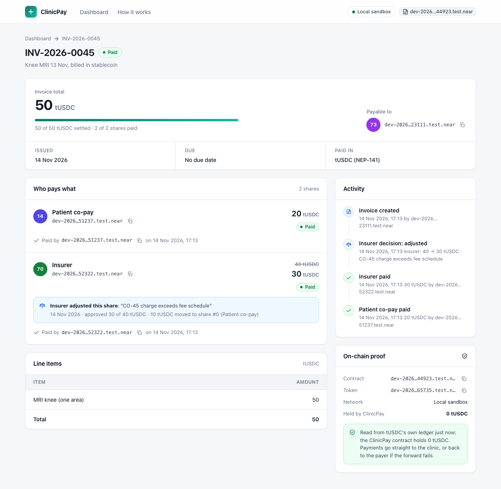

# ClinicPay

[](https://github.com/shahaman098/near-clinicpay/actions/workflows/ci.yml)

**Split-payer invoices for clinics, settled on NEAR with an on-chain receipt for every payment.**
Track: Real-World Money (`realworld`). Built at NEAR HACKATHON, 2026-11-13 to 2026-11-14.

Demo: [22-second video](docs/demo.mp4) · Repo: this one · Tests: 44 passing (24 unit, 8 sandbox e2e, 12 CLI/benchmark).

Fastest verification:

```sh
npm test && (cd contract && cargo test)   # 44 tests, no keys, no network funds
cd contract && cargo run --example demo   # settles two invoices, then shows a refund
```

## The problem

A private clinic bill is rarely paid by one person. The insurer owes one slice, the
patient owes the co-pay, sometimes an employer scheme owes a third. Today the clinic
chases each party by email, reconciles bank lines by hand, and cannot easily prove
who paid what and when. Refunds are another manual round trip.

## What ClinicPay does

- A clinic creates **one invoice** made of line items and **several shares**, each
  share naming who owes it (or "anyone").
- An invoice is priced in **native NEAR or in any NEP-141 token, such as a USDC
  stablecoin**. One token per invoice; amounts are in that token's own units.
- **Each share is paid separately**, from the payer's own NEAR account (`pay_share`
  for NEAR, `ft_transfer_call` on the token for stablecoins). The contract forwards
  the money to the clinic **in the same transaction**. It never holds funds.
- Every payment writes a **NEP-297 event** (`share_paid`), so the receipt is on-chain
  and indexable. The invoice flips to `Paid` once every share is paid.
- The clinic can **refund** a paid share. The money goes back to whoever paid it.
- If forwarding to the clinic fails, the payment is **rolled back and the payer is
  refunded** automatically (tested for NEAR and for tokens; for tokens the refund goes
  through the token's own `ft_resolve_transfer`, so nothing is ever stuck in ClinicPay).
- A zero-dependency **CLI** reads invoices straight from chain and exports an
  **accountant-ready CSV** (one row per share).

## How NEAR is used

| Piece | NEAR feature |
| --- | --- |
| `contract/src/lib.rs` | Rust contract on `near-sdk` 5: payable calls, `Promise` transfers, callbacks (`on_payout`, `on_refund`) for atomic rollback, NEP-297 event logs |
| `ft_on_transfer` | NEP-141 receiver: a stablecoin payment arrives via `ft_transfer_call`, is forwarded to the clinic with `ft_transfer`, and the callback (`on_ft_payout` / `on_ft_refund`) returns the unused amount so the token refunds the sender if the forward fails |
| `cli/` | NEAR JSON-RPC `query` / `call_function` views (no SDK needed) |
| tests | `near-workspaces` sandbox: the real wasm runs on a real local NEAR node |

Amounts are yoctoNEAR for NEAR invoices, or the token's smallest unit for token
invoices (USDC has 6 decimals, so 10 USDC is `10000000`).

### How one share is paid

```
 patient ── pay_share (NEAR) ─────────┐
 insurer ── ft_transfer_call (token) ─┤
                                      ▼
                                  ClinicPay ── forward in the same tx ──► clinic
                                      │
                                      ├─ share_paid event (NEP-297)
                                      ├─ clinic refund? ──► back to the payer
                                      └─ forward failed? ──► state reverted, payer refunded
```

The contract is the meeting point, never the destination: a successful payment
leaves the clinic's balance higher and ClinicPay's unchanged.

## Try it: do X, see Y

Requirements: Rust (stable, 1.95+ because of `near-sdk` 5.30) with the
`wasm32-unknown-unknown` target, Node 18+. No NEAR account, no keys, no network
funds needed: everything below runs on a local sandbox node.

1. **Run all tests.**
   ```sh
   npm test                      # 12 tests: CLI against a mock RPC node + price benchmark
   cd contract && cargo test     # 24 unit tests + 4 NEAR sandbox tests + 4 stablecoin sandbox tests
   ```
   You should see `test result: ok. 24 passed`, then `ok. 4 passed` twice.
   - `tests/sandbox.rs` (NEAR): deploys the wasm, creates an invoice, pays it from two
     accounts, asserts the clinic's balance rose by exactly 5 NEAR and that the
     contract kept nothing, refunds a share, and kills the clinic account to prove a
     failed payout is reverted and refunded.
   - `tests/sandbox_ft.rs` (stablecoin): also deploys `test-token/`, a minimal NEP-141
     token with 6 decimals standing in for USDC (it has no value and exists only for
     these tests). A 50 tUSDC invoice is paid 10 + 40 by patient and insurer via
     `ft_transfer_call`; the clinic's token balance becomes exactly 50 and ClinicPay's
     stays 0. With the clinic not registered on the token, the payment is reverted
     (`payment_reverted` event) and the patient gets all 10 back. A wrong amount or
     wrong payer is returned in full. A clinic refund returns the tokens to the patient.

2. **Run the live demo** (starts a local node and leaves it running):
   ```sh
   cd contract && cargo run --example demo
   ```
   It prints a contract id, accounts, an RPC URL, and the on-chain events for three
   payments: the patient's NEAR co-pay on `INV-2026-0042`, the same co-pay on
   `INV-2026-0043` (a 50 tUSDC invoice paid through a local 6-decimal test token),
   and then a failure: `INV-2026-0044` is created on a second token the clinic is not
   registered for, the forward fails, `payment_reverted` is emitted and the patient
   keeps their 10 tUSDC.

3. **Read it back** with the commands the demo prints, from the repo root:
   ```sh
   node cli/clinicpay.mjs status --contract <contract> --id INV-2026-0042 --rpc <rpc-url>
   node cli/clinicpay.mjs status --contract <contract> --id INV-2026-0043 --rpc <rpc-url>
   node cli/clinicpay.mjs export --contract <contract> --clinic <clinic> --rpc <rpc-url>
   ```
   `status` shows `PartiallyPaid`, the paid co-pay with payer and timestamp, the open
   insurer share, and the exact `near` CLI command that pays it. The second invoice
   shows `50 tUSDC` with its token contract, read from the token's `ft_metadata`.
   `export` prints the CSV with a `currency` column.

4. **Build the wasm** for deployment: `npm run build:wasm`
   (`contract/target/wasm32-unknown-unknown/release/clinicpay.wasm`).

### Contract API

| Call | Who | Notes |
| --- | --- | --- |
| `create_invoice(id, memo, lines, shares, due_ms, token?)` | clinic (becomes payee) | shares must sum to lines; `token` = NEP-141 contract, omit for NEAR |
| `pay_share(invoice_id, share_index)` | payer, `#[payable]` | NEAR invoices: attach exactly the share amount; forwarded to clinic |
| `refund_share(invoice_id, share_index)` | clinic, `#[payable]` | NEAR invoices: attach the share amount; goes to the original payer |
| token `ft_transfer_call(receiver_id = ClinicPay, amount, msg)` | payer | token invoices: `msg` = `{"invoice_id":"…","share_index":0}`, exact share amount, 1 yoctoNEAR, ~100 Tgas |
| token `ft_transfer_call(…, msg)` with `"action":"refund"` | clinic | token invoices: the share amount goes back to the original payer |
| `cancel_invoice(invoice_id)` | clinic | only while nothing is paid |
| `get_invoice`, `get_status`, `list_invoices` | view | status: Open, PartiallyPaid, Paid, Refunded, Overdue, Cancelled |

Build arguments for `create_invoice` without hand-writing yocto amounts:

```sh
node cli/clinicpay.mjs args --id INV-7 --memo "GP visit" \
  --line "Consultation=2" --line "Blood panel=3" \
  --share "Patient co-pay:patient.testnet=1" --share "Insurer:insurer.testnet=4"
```

The same invoice priced in a stablecoin (`<usdc-contract>` is the token's NEAR
account; check the current USDC contract id in the NEAR docs):

```sh
node cli/clinicpay.mjs args --id INV-8 --token <usdc-contract> --decimals 6 \
  --line "Consultation=20" --line "Blood panel=30" \
  --share "Patient co-pay:patient.testnet=10" --share "Insurer:insurer.testnet=40"
```

`status` and `export` read the token's `ft_metadata`, so amounts show as `50 USDC`
and the CSV has `currency` and `token_contract` columns. For an open share of a
token invoice, `status` prints the `ft_transfer_call` command that pays it.

Before a token invoice can be paid, **ClinicPay's account and the clinic's account
must each be registered on the token** (`storage_deposit`). If the clinic is not
registered, payments are reverted and refunded (that is the rollback test above).

### Check a price against NHS national costs (optional)

Before the bill goes on chain, the clinic can compare each line item to the
national average unit cost. It is advisory and off-chain; the contract never sees
these prices.

```sh
node bench/bench.mjs --code AB23Z --amount 700
node bench/bench.mjs --search acupuncture
```

```
AB23Z  Acupuncture for Pain Management
National average unit cost: £231.56
Your amount:                £700.00
Difference:                 +£468.44 (+202.3%) — out of line
```

Bundled data: 665 outpatient procedures from the **NHS England National Cost
Collection, National Schedule of NHS costs 2025/26** (Outpatient Procedures),
extracted 2026-11-14. Contains public sector information licensed under the
Open Government Licence v3.0. The tool is offline and read-only.

## Security notes

- The contract never custodies funds: payment is forwarded in the same call, and a
  failed forward reverts state and refunds the payer.
- `ft_on_transfer` only accepts tokens from the exact token contract the invoice was
  created with (`predecessor == invoice.token`), so calling it directly, or paying with
  a different token, is rejected and the sender is refunded.
- NEAR and token paths cannot be mixed: `pay_share` / `refund_share` reject token
  invoices, and `ft_on_transfer` rejects NEAR invoices.
- Exact-amount deposits only; a named share can only be paid by its named account.
- Invoices are immutable: there is no update path, so line items, shares and payers cannot be
  re-pointed after creation. A refund always targets the account that paid.
- Only the clinic that created an invoice can refund or cancel it.
- No keys in this repo. The CLI is read-only.

## Limitations (honest)

- Stablecoin settlement is tested with a local test token (6 decimals, like USDC), not
  with the real USDC contract, because nothing here is deployed to testnet or mainnet.
  Any standard NEP-141 token works the same way.
- No meta-transaction relayer yet, so payers still need a little NEAR for gas. No
  NEAR Intents yet, so payers need the token on NEAR (no cross-chain payment).
- The NHS benchmark is an England-wide 2025/26 national average, not a negotiated
  tariff, and it is advisory: it informs the clinic before invoicing, and the contract
  does not read it.
- `cargo run --example demo` shows both flows and one failure: the NEAR invoice, the
  stablecoin invoice paid through a local 6-decimal test token, then a payment the
  clinic cannot receive, which is reverted and refunded. `tests/sandbox_ft.rs` proves
  the other failure cases (wrong amount or wrong payer); `tests/sandbox.rs` proves a
  failed NEAR payout.
- `list_invoices` scans all invoices (fine at demo scale; needs an index at volume).
- `web/invoice.html` is a read-only viewer that uses the same RPC calls as the CLI. It
  was checked in Chrome against the local sandbox demo at desktop, tablet and mobile
  widths (no horizontal overflow), for a NEAR invoice and for a tUSDC invoice (the
  screenshot below is that run); it has not been used against testnet or mainnet. The
  tested interfaces are the contract and CLI.

  
- Not deployed to testnet or mainnet from this repo: deploying needs the team's own
  NEAR account. All demonstrated flows run on the local sandbox.
- Not audited. Do not use with real patient data.

## Libraries and baseline disclosure

- `near-sdk` 5.30, `near-workspaces` 0.24 (dev only), `tokio`, `serde_json`, `anyhow`.
- `test-token/`: `near-contract-standards` 5.30 fungible-token implementation, used only
  by the sandbox tests.
- CLI, page and benchmark: Node standard library and browser APIs only.
- `bench/nhs_outpatient_procedures_2025_26.csv`: extracted from the NHS England
  National Cost Collection (National Schedule of NHS costs 2025/26, Outpatient
  Procedures), licensed under the Open Government Licence v3.0.
- Everything in this repository was written during the hackathon window for this
  entry. It is inspired by the owner's product Boto (boto.clinic, a clinic OS), but
  no Boto code is included. Written with AI coding assistance (disclosed per hackathon rule Q-005).

## Layout

```
contract/src/lib.rs        the NEAR contract + unit tests
contract/tests/sandbox.rs  end-to-end tests on a local NEAR node (NEAR invoices)
contract/tests/sandbox_ft.rs  end-to-end tests with a NEP-141 token (stablecoin invoices)
test-token/                minimal NEP-141 test token for those tests (no value)
contract/examples/demo.rs  live local demo
cli/                       read-only CLI + tests
bench/                     NHS national cost benchmark (665 outpatient procedures) + tests
web/invoice.html           read-only invoice viewer
```

License: MIT.
