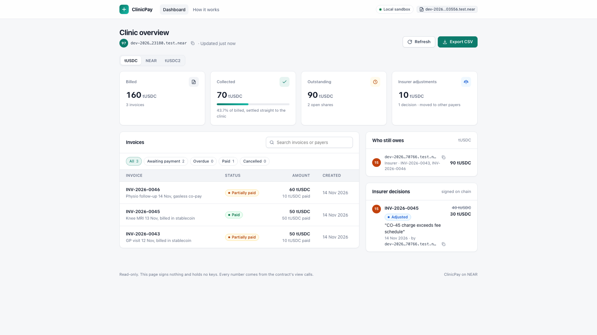
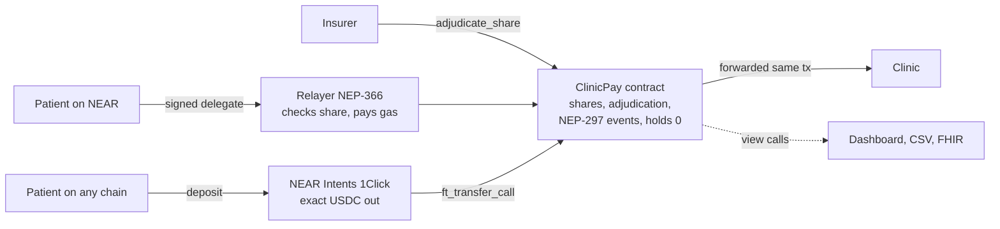
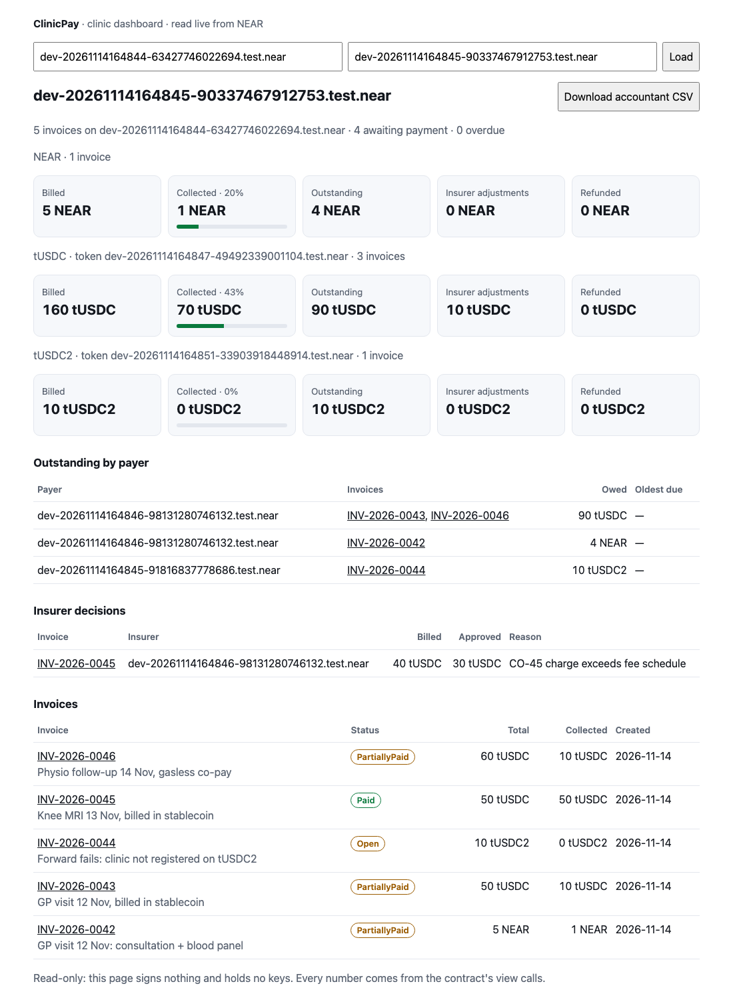
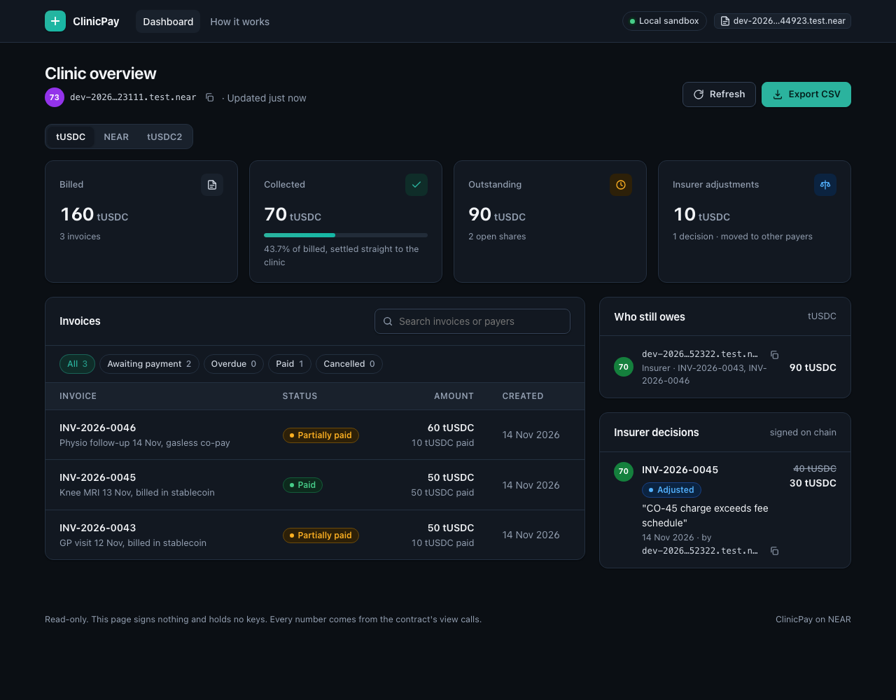

# ClinicPay

[](https://github.com/shahaman098/near-clinicpay/actions/workflows/ci.yml)

**One clinic bill, several payers (patient, insurer, employer), each share settled on NEAR in stablecoin, with the insurer's decision recorded on chain, no gas for the patient, and payment from any chain through NEAR Intents.**

[Live dashboard (testnet)](https://shahaman098.github.io/near-clinicpay/web/clinic.html?contract=clinicpay-demo-mwgv5r7s.testnet&clinic=clinicpay-demo-mwgv5r7s.testnet) ·
[Live invoice](https://shahaman098.github.io/near-clinicpay/web/invoice.html?contract=clinicpay-demo-mwgv5r7s.testnet&id=INV-TESTNET-1) ·
[Demo video](docs/demo.mp4) ·
[Benchmarks](docs/BENCHMARKS.md) ·
[NEAR Intents](docs/INTENTS.md)

> Built at NEAR HACKATHON, 2026-11-13 to 2026-11-14 · Track: **Real-World Money** (`realworld`) ·
> 99 tests passing (41 unit, 23 on a real local NEAR node, 35 CLI/relayer/benchmark)



**Live on testnet:** contract `clinicpay-demo-mwgv5r7s.testnet`, invoice `INV-TESTNET-1` (5 NEAR; the patient's 1 NEAR co-pay paid by a real testnet account). The links above read it straight from testnet; nothing to install. From a terminal:
`node cli/clinicpay.mjs status --contract clinicpay-demo-mwgv5r7s.testnet --id INV-TESTNET-1 --rpc https://rpc.testnet.near.org`

Verify everything in two commands (no keys, no network funds):

```sh
npm test && (cd contract && cargo test)   # 99 tests
cd contract && cargo run --example demo   # NEAR + stablecoin invoices, a rollback, insurer adjudication, a gasless payment
```

## The problem

A private clinic bill is rarely paid by one person. The insurer owes one slice, the
patient owes the co-pay, sometimes an employer scheme owes a third. Today the clinic
chases each party by email, reconciles bank lines by hand, and cannot easily prove
who paid what and when. Refunds are another manual round trip.

The numbers behind it:

- Providers collected about **48%** of patient balances in 2022–23 (Kodiak Solutions
  data, [RevCycleIntelligence](https://revcycleintelligence.com/news/patient-collection-rate-falls-to-nearly-48)).
- A **manual claim payment costs $3.48** per transaction across the US medical industry,
  versus $1.85 electronic ([CAQH Index 2024](https://www.caqh.org/hubfs/Index/2024%20Index%20Report/CAQH_IndexReport_2024_FINAL.pdf), claim payment table).
- Card processing on a co-pay typically costs **2.5–4.5%** per transaction
  ([Medical Economics](https://www.medicaleconomics.com/view/are-you-being-charged-too-much-for-credit-card-processing-fees-); vendor-sourced, indicative).

ClinicPay does not claim to raise collection rates; it removes the reconciliation,
the per-payment card fee and the "who paid what" ambiguity, and shows its costs below.

## What ClinicPay does

- A clinic creates **one invoice** made of line items and **several shares**, each
  share naming who owes it (or "anyone").
- An invoice is priced in **native NEAR or in any NEP-141 token, such as a USDC
  stablecoin**. One token per invoice; amounts are in that token's own units.
- **Each share is paid separately**, from the payer's own NEAR account (`pay_share`
  for NEAR, `ft_transfer_call` on the token for stablecoins). The contract forwards
  the money to the clinic **in the same transaction**. It never holds funds.
- Every payment writes a **NEP-297 event** (`share_paid`), so the receipt is on-chain
  and indexable. The invoice flips to `Paid` once every share is paid.
- The clinic can **refund** a paid share. The money goes back to whoever paid it.
- If forwarding to the clinic fails, the payment is **rolled back and the payer is
  refunded** automatically (tested for NEAR and for tokens; for tokens the refund goes
  through the token's own `ft_resolve_transfer`, so nothing is ever stuck in ClinicPay).
- **The insurer adjudicates on chain.** Before paying, the insurer named on a share
  records its claim decision with `adjudicate_share`: approve all, part (with a reason
  code such as `CO-45 charge exceeds fee schedule`) or nothing. The unapproved part
  moves to another open share, normally the patient's, so the shares still add up to
  the bill and the clinic is still paid in full. The decision is signed by the insurer,
  final, kept on the share (billed vs approved), and emitted as `share_adjudicated`.
  Paid shares never change.
- **Patients pay without holding NEAR.** A stablecoin share can be paid gaslessly: the
  patient signs a NEP-366 delegate action, and the ClinicPay relayer (`relayer/`) pays
  the gas and submits it. The relayer only pays for ClinicPay payments and claim
  decisions, and checks the share on chain first. In the sandbox tests the patient's
  NEAR balance changes by exactly 0.
- A **clinic dashboard** (`web/clinic.html`) reads every invoice of a clinic from
  chain: billed, collected, outstanding and insurer adjustments per currency, status
  filters and search, who still owes what, every insurer decision with its reason, and
  a one-click accountant CSV. Each invoice links to a payer-facing **invoice page**
  (`web/invoice.html`): who pays what, the insurer's billed-versus-approved amount and
  reason, an activity timeline, copyable pay commands, and an on-chain custody check.
  `web/index.html` is a short landing page that links to both. All three are plain
  HTML, CSS and ES modules with no build step, light and dark.
- A zero-dependency **CLI** reads invoices straight from chain and exports an
  **accountant-ready CSV** (one row per share, with billed vs approved amounts and the
  adjudication reason).

## What makes it different

- **The insurer's decision is a contract call, not an email.** `adjudicate_share`
  lets only the named insurer approve all, part or none of its share with an X12
  CARC-style reason (`CO-45 charge exceeds fee schedule`); the remainder moves to
  another share in the same call, and the contract refuses any decision that would
  stop the shares adding up to the bill.
- **The contract is a meeting point, never a wallet.** Every payment is forwarded to
  the clinic in the same transaction and rolled back if that fails; tests assert the
  contract holds 0 after every flow.
- **Patients pay without NEAR, or from any chain.** NEP-366 gasless payments (the
  patient's NEAR balance changes by exactly 0) and NEAR Intents 1Click delivery of an
  exact USDC amount into `ft_on_transfer`.
- **It speaks the industry's formats.** Accountant CSV per share and a FHIR R4
  `ClaimResponse` export with CARC-coded adjustments.

## How it works



Try the main workflow on the live testnet invoice (links at the top), or locally with
`cargo run --example demo`: the clinic creates `INV-2026-0045` for 50 tUSDC
(patient 10, insurer 40) → the insurer approves 30 with `CO-45` → 10 moves to the
patient → both pay → **expected outcome:** the dashboard shows the invoice Paid, the
clinic received exactly 50, the insurer card shows 40 struck through to 30, and
ClinicPay holds 0.

## Results and validation

Measured on a local NEAR node (nearcore 2.9.0) unless stated; regenerate with
`cd contract && cargo run --example bench -- 3.12`. Full method in
[docs/BENCHMARKS.md](docs/BENCHMARKS.md) and [docs/INTENTS.md](docs/INTENTS.md).

| Metric | Result | Evidence |
| --- | --- | --- |
| Gas for a stablecoin payment (receive, forward, receipt) | 11.3 Tgas ≈ $0.0035 at $3.12/NEAR | `examples/bench.rs` |
| Gas for an insurer adjudication | 2.2 Tgas | `examples/bench.rs` |
| Listing one clinic's invoices with 10 / 100 / 1,000 on the contract | 2.09 Tgas each (was 3.6 / 20.5 / 192.1 with a full scan) | scale section of BENCHMARKS |
| Storage per invoice | 440 bytes ≈ 0.0044 NEAR | `examples/bench.rs` |
| Patient's NEAR balance change on a gasless payment | exactly 0 yoctoNEAR | `tests/sandbox_relayer.rs`, demo act 13 |
| Funds left in ClinicPay after each payment, rollback and refund | 0 | asserted across the sandbox tests and the demo |
| Lowest gas at which a NEAR Intents delivery settles | 30 Tgas (the verifier's minimum) | `tests/sandbox_intents.rs` gas sweep |
| Rollback / refund at every gas level 15–50 Tgas | all-or-nothing, nothing stuck | `tests/sandbox_intents.rs` |
| Live 1Click quote, Base USDC → NEAR USDC | 10.10 in, exactly 10.000000 out, 0 withdraw fee | `docs/INTENTS.md` (dry quote; no real funds moved) |
| Tests | 99 passing, CI on every push | `npm test`, `cargo test` |

For scale: a card fee on a $50 co-pay is about $1.75 (2.9% + $0.30); a manual claim
payment costs $3.48 (CAQH 2024). Different units: order of magnitude, not a
like-for-like saving.

## Engineering challenges

- **Our own gas test passed for the wrong reason.** A NEAR Intents delivery arrives
  with as little as 30 Tgas. The first sweep counted a successful `ft_transfer_call`
  as settled, but `ft_transfer_call` succeeds even when the receiver runs out of gas
  and the tokens bounce back. Checking the share state instead showed we only settled
  at 45 Tgas. Lowering the static gas on the forward and its callback (15 → 8 Tgas
  each, with unused gas shared on top) made 30 Tgas settle, and a 15–50 Tgas sweep
  proves the rollback and the clinic refund stay all-or-nothing.
- **NEP-366 makes the relayer pay attached deposits.** A relayed `pay_share` would
  have charged the relayer, not the patient, for the NEAR share. The relayer now
  refuses NEAR-priced payments and relays only 1-yocto token transfers and 0-deposit
  adjudications, after checking the share on chain.
- **A full scan does not survive scale.** Listing a clinic's invoices cost 192 Tgas at
  1,000 invoices. A per-clinic index keeps it at 2.09 Tgas for 17 extra bytes per invoice.
- **Every on-chain failure read "unreachable".** `near-sdk` needs the `--cfg near`
  rustflag to route panic messages; with it, refusals now carry the contract's own text.

## Judging criteria → evidence

| Criterion | Where to look |
| --- | --- |
| Real-world value | The problem (sourced figures), insurer adjudication, CSV and FHIR exports |
| Technical execution | 99 tests, sandbox files, gas sweep, rollback proofs, CI |
| Use of NEAR | NEP-141 receive and forward, NEP-297 events, NEP-366 relayer, NEAR Intents 1Click, `near-workspaces` |
| Working demo | Live testnet dashboard and invoice, `cargo run --example demo` |
| Evidence | [BENCHMARKS](docs/BENCHMARKS.md), [INTENTS](docs/INTENTS.md), Results table above |
| Honesty | Limitations section below |

## How NEAR is used

| Piece | NEAR feature |
| --- | --- |
| `contract/src/lib.rs` | Rust contract on `near-sdk` 5: payable calls, `Promise` transfers, callbacks (`on_payout`, `on_refund`) for atomic rollback, NEP-297 event logs |
| `ft_on_transfer` | NEP-141 receiver: a stablecoin payment arrives via `ft_transfer_call`, is forwarded to the clinic with `ft_transfer`, and the callback (`on_ft_payout` / `on_ft_refund`) returns the unused amount so the token refunds the sender if the forward fails |
| `adjudicate_share` | the insurer's own account signs its claim decision; the predecessor check is the authorization |
| `relayer/` | NEP-366 meta transactions: payer-signed `DelegateAction`, relayer-signed transaction with `Action::Delegate`, hand-written borsh + ed25519 on Node's standard library, `send_tx` JSON-RPC |
| `cli/` | NEAR JSON-RPC `query` / `call_function` views (no SDK needed) |
| tests | `near-workspaces` sandbox: the real wasm runs on a real local NEAR node |

Amounts are yoctoNEAR for NEAR invoices, or the token's smallest unit for token
invoices (USDC has 6 decimals, so 10 USDC is `10000000`).

### How one share is paid

```
 insurer ── adjudicate_share ──► approves 30 of 40, 10 moves to the patient's share
 patient ── pay_share (NEAR) ─────────┐
 insurer ── ft_transfer_call (token) ─┤
 patient ── signed delegate ► relayer ┤   (gasless: relayer pays gas, patient pays 0 NEAR)
                                      ▼
                                  ClinicPay ── forward in the same tx ──► clinic
                                      │
                                      ├─ share_paid event (NEP-297)
                                      ├─ clinic refund? ──► back to the payer
                                      └─ forward failed? ──► state reverted, payer refunded
```

The contract is the meeting point, never the destination: a successful payment
leaves the clinic's balance higher and ClinicPay's unchanged.

## Try it: do X, see Y

Requirements: Rust (stable, 1.95+ because of `near-sdk` 5.30) with the
`wasm32-unknown-unknown` target, Node 18+. No NEAR account, no keys, no network
funds needed: everything below runs on a local sandbox node.

1. **Run all tests.**
   ```sh
   npm test                      # 35 tests: CLI (mock RPC), Intents client, relayer policy, benchmark
   cd contract && cargo test     # 41 unit + 4 NEAR + 5 stablecoin + 5 gasless + 2 deploy-tool + 7 Intents sandbox tests
   ```
   You should see `test result: ok. 41 passed`, then (one per sandbox file, in name
   order) `ok. 4 passed`, `ok. 5 passed`, `ok. 7 passed`, `ok. 2 passed`, `ok. 5 passed`.
   - `tests/sandbox.rs` (NEAR): deploys the wasm, creates an invoice, pays it from two
     accounts, asserts the clinic's balance rose by exactly 5 NEAR and that the
     contract kept nothing, refunds a share, and kills the clinic account to prove a
     failed payout is reverted and refunded.
   - `tests/sandbox_ft.rs` (stablecoin): also deploys `test-token/`, a minimal NEP-141
     token with 6 decimals standing in for USDC (it has no value and exists only for
     these tests). A 50 tUSDC invoice is paid 10 + 40 by patient and insurer via
     `ft_transfer_call`; the clinic's token balance becomes exactly 50 and ClinicPay's
     stays 0. With the clinic not registered on the token, the payment is reverted
     (`payment_reverted` event) and the patient gets all 10 back. A wrong amount or
     wrong payer is returned in full. A clinic refund returns the tokens to the patient.
     The insurer adjudicates 40 down to 30 on chain; paying the old 40 is returned in
     full, then insurer 30 + patient 20 settle it and the clinic still gets exactly 50.
   - `tests/sandbox_relayer.rs` (gasless): runs `relayer/payer.mjs` and
     `relayer/relayer.mjs` as real processes against the node. The patient pays a tUSDC
     share with a signed delegate; their NEAR balance is unchanged to the yoctoNEAR,
     `paid_by` is the patient (not the relayer), and the relayer's balance drops. The
     insurer adjudicates gaslessly too. The relayer refuses a patient paying the
     insurer's named share, an adjudication the contract would reject, malformed input
     and a resubmitted delegate, each without spending anything. One test runs the
     HTTP relayer (`serve`) and pays through it with `payer.mjs --relayer`.

2. **Run the live demo** (starts a local node and leaves it running):
   ```sh
   cd contract && cargo run --example demo
   ```
   It prints a contract id, accounts, an RPC URL, and the on-chain events for three
   payments: the patient's NEAR co-pay on `INV-2026-0042`, the same co-pay on
   `INV-2026-0043` (a 50 tUSDC invoice paid through a local 6-decimal test token),
   and then a failure: `INV-2026-0044` is created on a second token the clinic is not
   registered for, the forward fails, `payment_reverted` is emitted and the patient
   keeps their 10 tUSDC. Then `INV-2026-0045`: the insurer approves 30 of 40 tUSDC on
   chain (`share_adjudicated`, reason `CO-45`), 10 moves to the patient, both pay, the
   clinic gets 50. Last, `INV-2026-0046`: the patient pays their co-pay through the
   relayer and the demo prints the change in their NEAR balance: 0.

3. **Read it back** with the commands the demo prints, from the repo root:
   ```sh
   node cli/clinicpay.mjs status --contract <contract> --id INV-2026-0042 --rpc <rpc-url>
   node cli/clinicpay.mjs status --contract <contract> --id INV-2026-0043 --rpc <rpc-url>
   node cli/clinicpay.mjs status --contract <contract> --id INV-2026-0045 --rpc <rpc-url>
   node cli/clinicpay.mjs export --contract <contract> --clinic <clinic> --rpc <rpc-url>
   node cli/clinicpay.mjs export-fhir --contract <contract> --id INV-2026-0045 --rpc <rpc-url>
   ```
   `status` shows `PartiallyPaid`, the paid co-pay with payer and timestamp, the open
   insurer share, and the `near` CLI command that pays it on testnet (`--network
   mainnet` when the contract lives there; the demo's sandbox port is not a near-cli
   network, so that command is for a real deployment). The second invoice
   shows `50 tUSDC` with its token contract, read from the token's `ft_metadata`.
   `INV-2026-0045` shows the insurer's line `billed 40, approved 30 tUSDC ("CO-45 …");
   10 tUSDC moved to share #0`. `export` prints the CSV with `currency`,
   `billed_amount`, `approved_amount`, `adjustment_reason`, `adj_group` and `adj_carc`
   columns (835-style, not X12 835). `export-fhir` prints a FHIR R4 `ClaimResponse`
   with `submitted` and `benefit` adjudication and the CARC coding.

4. **Open the clinic dashboard and invoice pages**: serve the repo
   (`python3 -m http.server 8080`) and open the two URLs the demo prints. The dashboard
   shows 160 tUSDC billed, 70 collected, 90 outstanding and 10 adjusted by the
   insurer, plus the `CO-45` decision. Its CSV button downloads the same CSV as
   `export`, because it imports the CLI's own `invoicesToCsv`.

   

   Dark mode follows the system setting:

   

5. **Build the wasm** for deployment: `npm run build:wasm`
   (`contract/target/wasm32-unknown-unknown/release/clinicpay.wasm`).

### Contract API

| Call | Who | Notes |
| --- | --- | --- |
| `create_invoice(id, memo, lines, shares, due_ms, token?)` | clinic (becomes payee) | shares must sum to lines; `token` = NEP-141 contract, omit for NEAR |
| `pay_share(invoice_id, share_index)` | payer, `#[payable]` | NEAR invoices: attach exactly the share amount; forwarded to clinic |
| `refund_share(invoice_id, share_index)` | clinic, `#[payable]` | NEAR invoices: attach the share amount; goes to the original payer |
| token `ft_transfer_call(receiver_id = ClinicPay, amount, msg)` | payer | token invoices: `msg` = `{"invoice_id":"…","share_index":0}`, exact share amount, 1 yoctoNEAR, ~100 Tgas |
| token `ft_transfer_call(…, msg)` with `"action":"refund"` | clinic | token invoices: the share amount goes back to the original payer |
| `adjudicate_share(invoice_id, share_index, approved, reason, move_to?)` | the share's named payer (insurer) | once, while the share is Open; `approved` ≤ billed; the rest moves to open share `move_to`; `approved = 0` marks the share `Denied` |
| `cancel_invoice(invoice_id)` | clinic | only while nothing is paid |
| `get_invoice`, `get_status`, `list_invoices` | view | status: Open, PartiallyPaid, Paid, Refunded, Overdue, Cancelled |

Status rules: a refunded or denied share counts as closed, so an invoice is `Paid` once no
share is `Open` (even if one was refunded instead); `Overdue` takes precedence over
`PartiallyPaid` when the due date has passed.

Build arguments for `create_invoice` without hand-writing yocto amounts:

```sh
node cli/clinicpay.mjs args --id INV-7 --memo "GP visit" \
  --line "Consultation=2" --line "Blood panel=3" \
  --share "Patient co-pay:patient.testnet=1" --share "Insurer:insurer.testnet=4"
```

The same invoice priced in a stablecoin (`<usdc-contract>` is the token's NEAR
account; check the current USDC contract id in the NEAR docs):

```sh
node cli/clinicpay.mjs args --id INV-8 --token <usdc-contract> --decimals 6 \
  --line "Consultation=20" --line "Blood panel=30" \
  --share "Patient co-pay:patient.testnet=10" --share "Insurer:insurer.testnet=40"
```

`status` and `export` read the token's `ft_metadata`, so amounts show as `50 USDC`
and the CSV has `currency` and `token_contract` columns. For an open share of a
token invoice, `status` prints the `ft_transfer_call` command that pays it.

Before a token invoice can be paid, **ClinicPay's account and the clinic's account
must each be registered on the token** (`storage_deposit`). If the clinic is not
registered, payments are reverted and refunded (that is the rollback test above).

### Deploy to testnet (or any network) without near-cli

```sh
npm run build:wasm
# deploy + init in one transaction; the 262 KB wasm needs ~2.7 NEAR for storage
DEPLOY_ACCOUNT_ID=clinicpay-demo.testnet DEPLOY_PRIVATE_KEY=ed25519:... node ops/deploy.mjs
# the clinic creates (or cancels) an invoice with its own key
CLINIC_ACCOUNT_ID=clinic-demo.testnet CLINIC_PRIVATE_KEY=ed25519:... node ops/clinic.mjs create \
  --contract clinicpay-demo.testnet --id INV-8 --memo "GP visit" \
  --line "Consultation=2" --line "Blood panel=3" \
  --share "Patient co-pay:patient-demo.testnet=1" --share "Insurer:insurer-demo.testnet=4"
# for stablecoin invoices: register ClinicPay and the clinic on the token first
# (pays storage_deposit for whichever is missing; safe to run twice)
CLINIC_ACCOUNT_ID=clinic-demo.testnet CLINIC_PRIVATE_KEY=ed25519:... node ops/clinic.mjs register \
  --contract clinicpay-demo.testnet --token usdc.testnet
```

Then open `web/clinic.html?contract=clinicpay-demo.testnet&clinic=clinic-demo.testnet`
(testnet RPC is the default). `tests/sandbox_ops.rs` runs exactly these two tools against
a local node: deploy and init, create, cancel, token registration followed by a
paid token invoice, an upgrade with `--no-init` that keeps
the state, and a clinic error that comes back with the contract's message. Keys come
from the environment only, and the test checks that no key is printed.

### Gasless payments (NEP-366 relayer)

```sh
# relayer (key from the environment only; pays gas for ClinicPay payments and adjudications only)
RELAYER_ACCOUNT_ID=relayer.testnet RELAYER_PRIVATE_KEY=ed25519:... \
  node relayer/relayer.mjs serve --contract <clinicpay> --token <usdc-contract> --port 3030

# payer: signs a delegate action for their share and posts it; spends the share in USDC and 0 NEAR
PAYER_ACCOUNT_ID=patient.testnet PAYER_PRIVATE_KEY=ed25519:... \
  node relayer/payer.mjs pay --contract <clinicpay> --id INV-8 --share 0 --relayer http://localhost:3030

# insurer: records its claim decision without gas
PAYER_ACCOUNT_ID=insurer.testnet PAYER_PRIVATE_KEY=ed25519:... \
  node relayer/payer.mjs adjudicate --contract <clinicpay> --id INV-8 --share 1 \
  --approved 30000000 --reason "CO-45 charge exceeds fee schedule" --move-to 0 --relayer http://localhost:3030
```

What the relayer pays for (`relayer/policy.mjs`), one function call per delegate:
`adjudicate_share` on ClinicPay with no deposit, or `ft_transfer_call` on a listed token
with `receiver_id` = ClinicPay, 1 yoctoNEAR, a ClinicPay payment `msg`, ≤150 Tgas and a
delegate valid for ≤1000 blocks. Before building a transaction it reads the invoice and
refuses unless the share is open, the sender is its named payer (if any), and the
amount matches exactly. For a token payment it also checks that the sender holds the
amount and that ClinicPay and the clinic are both registered on the token. For
`adjudicate_share` it applies the contract's rules (approved ≤ billed, a valid open
`move_to`, not adjudicated before). Those are the failure causes it checks before it
spends gas; a state change between its check and execution (another payment landing
first) can still make a relayed call fail, at the relayer's gas cost.

Found while testing, and why NEAR invoices are not relayed: under NEP-366 the
**relayer** funds any deposit attached inside the delegate, not the signer. A relayed
`pay_share` would pay the clinic with the relayer's NEAR. The first version of the
sandbox test caught this (the patient's balance did not move, the relayer's dropped by
1 NEAR plus gas), so `pay_share` is refused and NEAR shares are paid directly.

### Check a price against NHS national costs (optional)

Before the bill goes on chain, the clinic can compare each line item to the
national average unit cost. It is advisory and off-chain; the contract never sees
these prices.

```sh
node bench/bench.mjs --code AB23Z --amount 700
node bench/bench.mjs --search acupuncture
```

```
AB23Z  Acupuncture for Pain Management
National average unit cost: £231.56
Your amount:                £700.00
Difference:                 +£468.44 (+202.3%) — out of line
```

Bundled data: 665 outpatient procedures from the **NHS England National Cost
Collection, National Schedule of NHS costs 2025/26** (Outpatient Procedures),
extracted 2026-11-14. Contains public sector information licensed under the
Open Government Licence v3.0. The tool is offline and read-only. The bands
(±10% in line, ±25% notable) are a rule of thumb, not a contractual threshold.

### Measure gas and storage

```sh
cd contract && cargo run --example bench -- 3.12 2026-11-14
```

Eight operations on a local sandbox (create, NEAR pay, token pay, adjudicate, refund,
cancel, two relayed calls), gas summed over the transaction and receipts, storage per
invoice at 1e19 yocto/byte, and a zero-custody assertion. Writes
[`docs/BENCHMARKS.md`](docs/BENCHMARKS.md). The NEAR/USD rate is an argument; without
it the report stays in NEAR.

### Pay from another chain (NEAR Intents)

A patient can pay an **open** share from what they already hold, and the clinic
receives the exact share in USDC on NEAR. Dry by default; `--live` returns a deposit
address. Mainnet only, because 1Click has no testnet.

```sh
node cli/clinicpay.mjs pay-from-any-chain --contract <contract> --id INV-2026-0045 \
  --share 0 --from base:USDC --refund-to 0xYourAddress
node cli/clinicpay.mjs intent-status --deposit <deposit-address>
```

The CLI preflights the invoice (token invoice, open share, no named payer, both
parties registered on the token, the token is a 1Click asset) and refuses a quote
whose `minAmountOut` is not exactly the share or that charges a withdraw fee. The
sandbox proves the delivery at the verifier's 50 Tgas default and 30 Tgas minimum, including the rollback when the
clinic cannot receive the token: [`docs/INTENTS.md`](docs/INTENTS.md).

## Security notes

- The contract never custodies funds: payment is forwarded in the same call, and a
  failed forward reverts state and refunds the payer.
- `ft_on_transfer` only accepts tokens from the exact token contract the invoice was
  created with (`predecessor == invoice.token`), so calling it directly, or paying with
  a different token, is rejected and the sender is refunded.
- NEAR and token paths cannot be mixed: `pay_share` / `refund_share` reject token
  invoices, and `ft_on_transfer` rejects NEAR invoices.
- Exact-amount deposits only; a named share can only be paid by its named account.
- Line items, payers and the payee never change after creation. The only change to
  amounts is `adjudicate_share`: signed by the share's named payer, once, only on open
  shares, and the shares must still sum to the bill (checked on chain). A refund always
  targets the account that paid.
- Failed calls report their reason on chain (e.g. `this share must be paid by its
  named payer`): the wasm is built with `--cfg near` (`.cargo/config.toml`), which
  `near-sdk` needs to route panics to the host.
- Only the clinic that created an invoice can refund or cancel it.
- No keys in this repo. The CLI is read-only. The relayer and payer tools read keys
  from environment variables only and never print them.

## Limitations (honest)

- Stablecoin settlement is tested with a local test token (6 decimals, like USDC), not
  with the real USDC contract, because the testnet deployment has no USDC registration.
  Any standard NEP-141 token works the same way.
- Gasless payment covers stablecoin shares and adjudication. NEAR-priced shares are
  paid directly (see above). The relayer enforces a sliding-window budget per payer and
  globally (`RELAYER_MAX_TX_PER_PAYER`, `RELAYER_MAX_TX_GLOBAL`,
  `RELAYER_MAX_GAS_GLOBAL`, `RELAYER_BUDGET_WINDOW_MS`); the defaults are demo-sized.
  The budget lives in memory, so it applies to the long-running `serve` mode; each
  one-off `submit` run starts with a fresh budget.
  Cross-chain payment is priced through NEAR Intents (1Click) and proven on a sandbox
  against the verifier's 50 Tgas default and 30 Tgas minimum; 1Click is mainnet-only, so it has
  not run end to end with real funds. See `docs/INTENTS.md`.
- The NHS benchmark is an England-wide 2025/26 national average, not a negotiated
  tariff, and it is advisory: it informs the clinic before invoicing, and the contract
  does not read it.
- `cargo run --example demo` shows the NEAR invoice, the stablecoin invoice paid
  through a local 6-decimal test token, a payment the clinic cannot receive (reverted
  and refunded), an insurer adjudication, and a gasless payment. `tests/sandbox_ft.rs` proves
  the other failure cases (wrong amount or wrong payer); `tests/sandbox.rs` proves a
  failed NEAR payout.
- The insurer chooses which open share absorbs an adjustment (normally the patient's,
  but it could be an employer scheme's). A production version would let the clinic
  mark, per invoice, which share takes adjustments.
- `list_invoices` pages a per-clinic index, so its gas is flat in how many other clinics' invoices exist (2.09 Tgas at 10, 100 and 1,000 invoices; see `docs/BENCHMARKS.md`). A single clinic with a very large list still pays to rewrite that list on create and read it on page (5.1 Tgas at 1,000).
- `create_invoice` charges no storage deposit, so invoice state is subsidised by the
  contract account; a production deployment should charge one.
- A reverted payout is refunded with a plain transfer. If the payer account no longer
  exists, that transfer fails and the funds stay in the contract, with no automatic
  recovery path.
- `web/index.html`, `web/invoice.html` and `web/clinic.html` are read-only pages (no
  keys, no signing) that use the same RPC calls as the CLI, with shared styles in
  `web/app.css` and helpers in `web/ui.mjs`. In Chrome, against the local sandbox demo,
  I checked: no horizontal overflow at 375, 768 and 1280 px on the landing page, the
  dashboard, both connect screens, the not-found and RPC-error states, and invoices
  `INV-2026-0042` to `0046` (including the adjudicated `0045`, screenshot below, and
  the gasless `0046`); that both connect forms submit and load the right page; dark
  mode on the landing page, the dashboard and one open invoice (`0043`); the dashboard
  totals (160 / 70 / 90 / 10 tUSDC) by hand against the demo; the currency tabs,
  status chips, search, Enter on an invoice link, and that the CSV button produces the
  same text as `cli export`. The pages have no automated browser tests, were not tried
  in Safari or Firefox, and have not been used against mainnet (the testnet invoice is
  read with the CLI).

  
- Deployed to **testnet only** (`clinicpay-demo-mwgv5r7s.testnet`); mainnet is not
  deployed. The stablecoin and gasless and Intents flows are demonstrated on the local
  sandbox; the live testnet invoice is NEAR-priced.
- Not audited. Do not use with real patient data.

## What's next

1. One real cross-chain payment on mainnet (runbook ready; needs a funded mainnet
   account and real USDC).
2. A storage deposit on `create_invoice`, and clinic-chosen adjustment shares.
3. A pilot with one private clinic, starting with insurer-adjusted co-pays.

## Libraries and baseline disclosure

- `near-sdk` 5.30, `near-workspaces` 0.24 (dev only), `tokio`, `serde_json`, `anyhow`.
- `test-token/`: `near-contract-standards` 5.30 fungible-token implementation, used only
  by the sandbox tests.
- CLI, relayer, ops tools, pages and benchmark: Node standard library and browser APIs only
  (the relayer's borsh, base58 and ed25519 signing are written against
  `near-primitives` 0.38 layouts and verified by the sandbox node accepting them).
- `bench/nhs_outpatient_procedures_2025_26.csv`: extracted from the NHS England
  National Cost Collection (National Schedule of NHS costs 2025/26, Outpatient
  Procedures), licensed under the Open Government Licence v3.0.
- Everything in this repository was written during the hackathon window for this
  entry. It is inspired by the owner's product Boto (boto.clinic, a clinic OS), but
  no Boto code is included. Written with AI coding assistance (disclosed per hackathon rule Q-005).

## Layout

```
contract/src/lib.rs        the NEAR contract + unit tests
contract/tests/sandbox.rs  end-to-end tests on a local NEAR node (NEAR invoices)
contract/tests/sandbox_ft.rs  end-to-end tests with a NEP-141 token (stablecoin invoices, adjudication)
contract/tests/sandbox_relayer.rs  end-to-end gasless payments through the relayer
contract/tests/sandbox_ops.rs  end-to-end deploy + clinic tools
contract/tests/sandbox_intents.rs  NEAR Intents-style deliveries, gas sweeps, rollback and refund at every gas level
contract/examples/bench.rs gas, storage and scale benchmark (writes docs/BENCHMARKS.md)
ops/                       deploy.mjs (deploy + init) and clinic.mjs (create / cancel / register on a token), keys from env
relayer/                   NEP-366 relayer (policy, serve/submit) + payer signer + tests
test-token/                minimal NEP-141 test token for those tests (no value)
contract/examples/demo.rs  live local demo
cli/                       read-only CLI (status, CSV, FHIR, pay-from-any-chain via 1Click) + tests
docs/                      BENCHMARKS.md, INTENTS.md, demo video, hero screenshot
bench/                     NHS national cost benchmark (665 outpatient procedures) + tests
web/index.html             landing page
web/invoice.html           read-only invoice page (payer view)
web/clinic.html            read-only clinic dashboard + CSV download
web/app.css, web/ui.mjs    shared design system and UI helpers
```

License: MIT.
